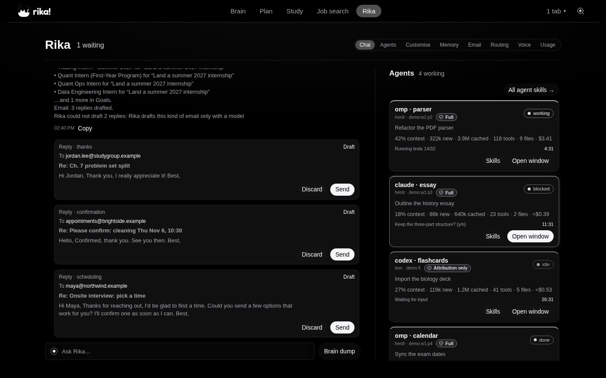
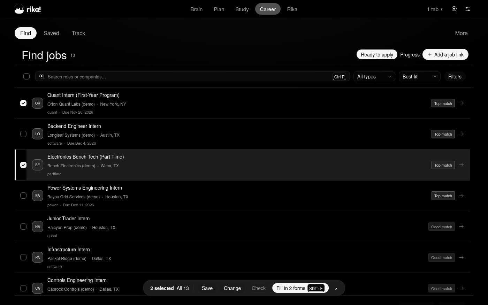
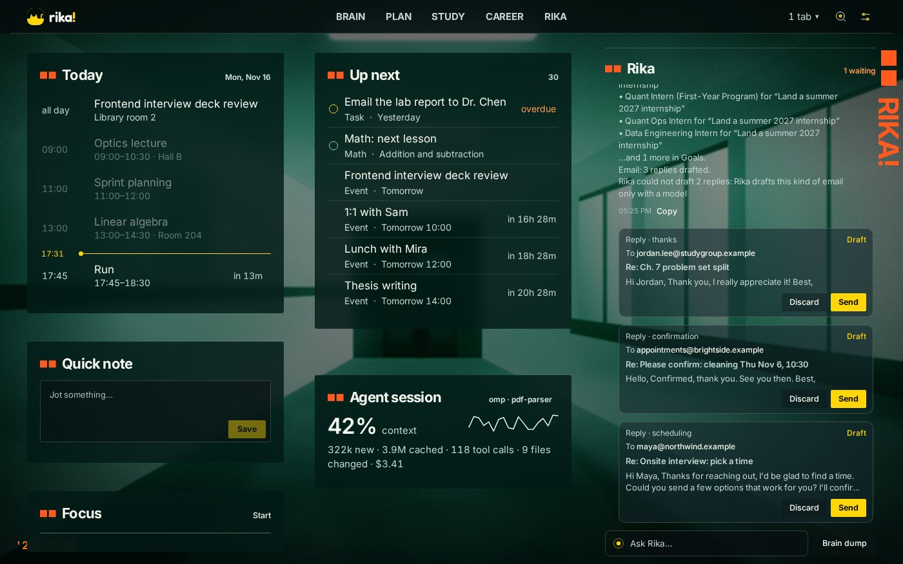
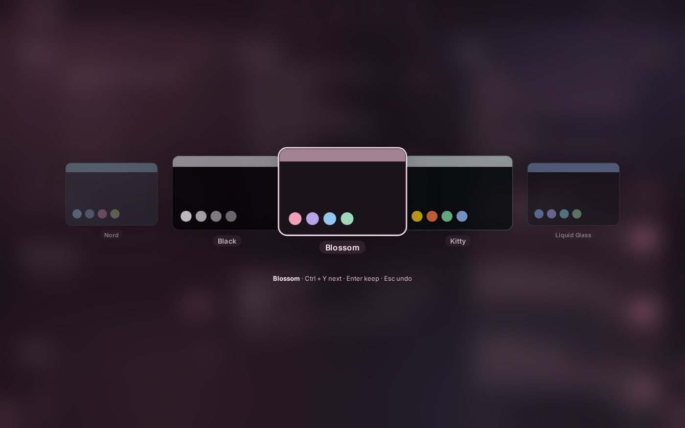
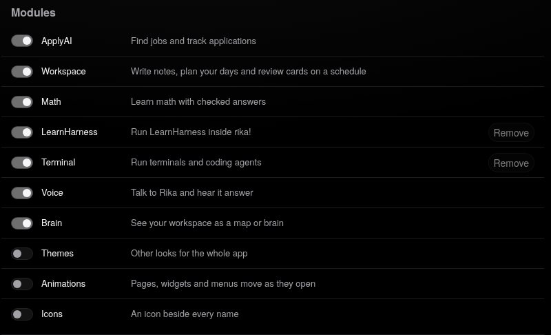

  

  Notes become connections. Connections become something you can build. 
  A local-first desktop workspace for your notes, documents, study and plans.

  
  
  
  

  <b><a href="https://github.com/ZacharySF/rika/releases/latest">Download for Linux ↗</a></b>
  &nbsp; / &nbsp; <a href="#install">Install</a>
  &nbsp; / &nbsp; <a href="#a-look-around">A look around</a> 
  Local-first · No account needed · One SQLite workspace on your machine

  <a href="#at-a-glance">At a glance</a> ·
  <a href="#install">Install</a> ·
  <a href="#updates-and-your-data">Updates and your data</a> ·
  <a href="#a-look-around">A look around</a> ·
  <a href="#keys-worth-knowing">Keys</a> ·
  <a href="#about-this-repository">About</a>

 

<b>A little less scattered. A lot more connected.</b>

  

Home: today, what's next, and Rika on the right with your replies already drafted.

 

## At a glance

<table>
  <tr>
    <td width="33%" valign="top">
      <b>Write</b> 
      Blocks, <code>[[wiki]]</code> links and <code>((block))</code> references. Documents, PDFs, canvases, mind maps and floating quick notes.
    </td>
    <td width="33%" valign="top">
      <b>Plan</b> 
      A calendar, tasks and goals, with flashcards and study beside the material you're learning.
    </td>
    <td width="33%" valign="top">
      <b>See</b> 
      The Brain: every record and every edit as a point on a 3D brain or a flat 2D map.
    </td>
  </tr>
  <tr>
    <td width="33%" valign="top">
      <b>Delegate</b> 
      Rika reads what changed, drafts the replies and keeps an eye on your coding agents. You press Send.
    </td>
    <td width="33%" valign="top">
      <b>Shape</b> 
      Rearrange any page, start home from eighteen templates, and pick Black or seventeen other themes.
    </td>
    <td width="33%" valign="top">
      <b>Grow</b> 
      Switch modules on and off. Heavy parts download as signed packs only when you ask for them.
    </td>
  </tr>
</table>

 

## Install

1. **[Download the latest release.](https://github.com/ZacharySF/rika/releases/latest)**
2. Install the `.deb` with your software installer, or run the AppImage.
3. Open rika! from your application launcher and choose **Start locally**.

  

First launch: one button to start locally. No account needed.

### Which file?

| Your system | Download | How |
| --- | --- | --- |
| Ubuntu 22.04+ and compatible Debian-based desktops | `kitty_<version>_amd64.deb` | Open it in your software installer and approve. It brings its own dependencies and a **rika!** menu entry. |
| Other Linux desktops (x86_64, glibc 2.35+) | `kitty_<version>_amd64.AppImage` | Keep it in a writable folder such as `~/Applications`, allow it to run as a program, and double-click it. Needs FUSE (`libfuse2` on Ubuntu 22.04). |
| NixOS | the AppImage | Run it through `appimage-run`, which keeps signed self-updates working. |

The files still carry the project's earlier name, `kitty`; the app installs as
**rika! Workspace** (package `rika-workspace`) and has nothing to do with the
`kitty` terminal. These installers don't cover ARM, Windows or macOS.

 

## Updates and your data

- **Updates are signed.** Use **Check for updates** in the app or the tray menu,
  then **Download update** and **Install and restart**. The app checks every
  installer against the key built into it before it touches anything.
- **Your workspace lives apart from the app.** Notes, databases and settings stay
  in `~/.local/share/kitty/workspace` by default and are reused in place. Updating, replacing
  or uninstalling the app leaves them alone, so back them up like any personal data.
- **Modules download only when you ask.** The Brain, Themes, Voice, Math and
  others come as packs from the same release, checked against a signed list and
  their SHA-256 before they're used.
- **No account needed.** Choose **Start locally** and your workspace is one
  SQLite database on your machine; Google sign-in is optional.

 

## A look around

### Follow the thread

Every record and every edit becomes a glowing point in the **Brain**: a
neural-network map of everything you've written, studied and planned. Prefer
flat ground? Switch to the **2D** map.

### Give it somewhere to go

Put the next step on your calendar: one quiet row of controls, a line for now,
and the day you picked beside it.

### Someone to hand the loose ends to

Rika reads what changed overnight and tells you in a few lines. She drafts the
replies; **you** press Send. Her own page shows the coding agents working for you,
and **Ctrl + R** docks her beside any page.

### Looking for work? Three tabs, one bar.

Turn on ApplyAI and **Career** keeps the search in one place: **Find**, **Saved**
and **Track**. Tick the jobs and press Fill: rika! fills in the forms and stops
before Submit, every time.

### Your desk, not ours

Press **Ctrl + Shift + Space** on any page. Drag a block where you want it, pull
an edge to resize it, and open **Widgets** to drag in a clock, a quick note or
your goals.

### Black by default. Loud when you want it.

rika! opens in **Black**: white type, hairlines, nothing glowing. Turn Themes on
for seventeen more, and press **Ctrl + Y** to slide through them live. Turn
Animations on if you want pages to turn instead of blink.

  
  

Left: the Kitty theme. Right: Ctrl + Y, previewing Blossom.

### Only the parts you want

Keep the workspace, add a terminal when you're building, turn on ApplyAI when
you're looking for work, or download the Brain, Themes and Animations. Disabled
modules disappear; their data stays.

  

Screenshots use a demo workspace with synthetic data.

 

## Keys worth knowing

| Keys | What they do |
| --- | --- |
| <kbd>Ctrl</kbd> <kbd>Space</kbd> or <kbd>Ctrl</kbd> <kbd>K</kbd> | Search commands, sections and jobs |
| <kbd>Ctrl</kbd> <kbd>Shift</kbd> <kbd>Space</kbd> | Edit the page you're on |
| <kbd>Ctrl</kbd> <kbd>R</kbd> | Rika beside the page; again or Esc to close |
| <kbd>Ctrl</kbd> <kbd>J</kbd> | Ask Rika from anywhere but a terminal |
| <kbd>Ctrl</kbd> <kbd>O</kbd> | Every open tab as a card: arrows or 1–9, Enter to open |
| <kbd>Ctrl</kbd> <kbd>Tab</kbd> · <kbd>Ctrl</kbd> <kbd>T</kbd> · <kbd>Ctrl</kbd> <kbd>W</kbd> | Next tab · new tab · close tab |
| <kbd>Ctrl</kbd> <kbd>Y</kbd> | Slide through your themes live |
| <kbd>Ctrl</kbd> <kbd>Shift</kbd> <kbd>F</kbd> | Fill the window with the focused panel |
| <kbd>?</kbd> | Every shortcut for the screen you're on |

 

## About this repository

This repository holds the official installers, module packs and signed update
metadata. The application source is maintained in a separate private repository.
The LearnHarness pack includes its corresponding source and licences.

**Never share your workspace, credentials, resumes or private database in an issue.**

The wordmark uses <a href="https://fraunces.undercase.xyz">Fraunces</a> by Undercase Type, embedded under the <a href="docs/assets/OFL-Fraunces.txt">SIL Open Font License</a>.
