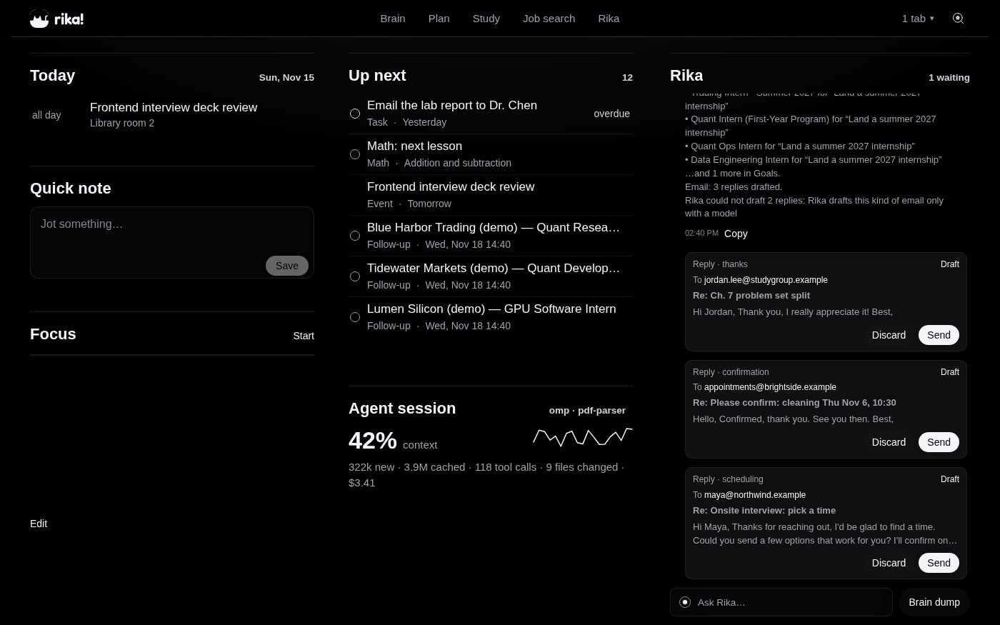
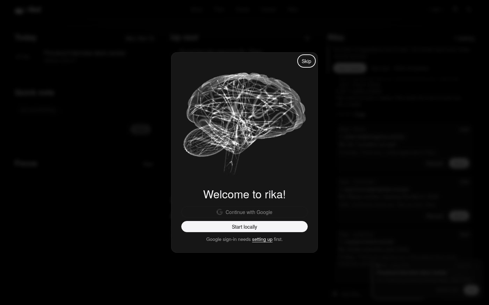
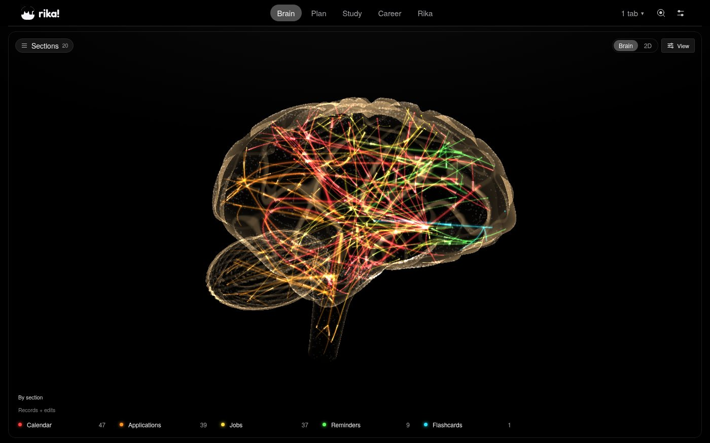
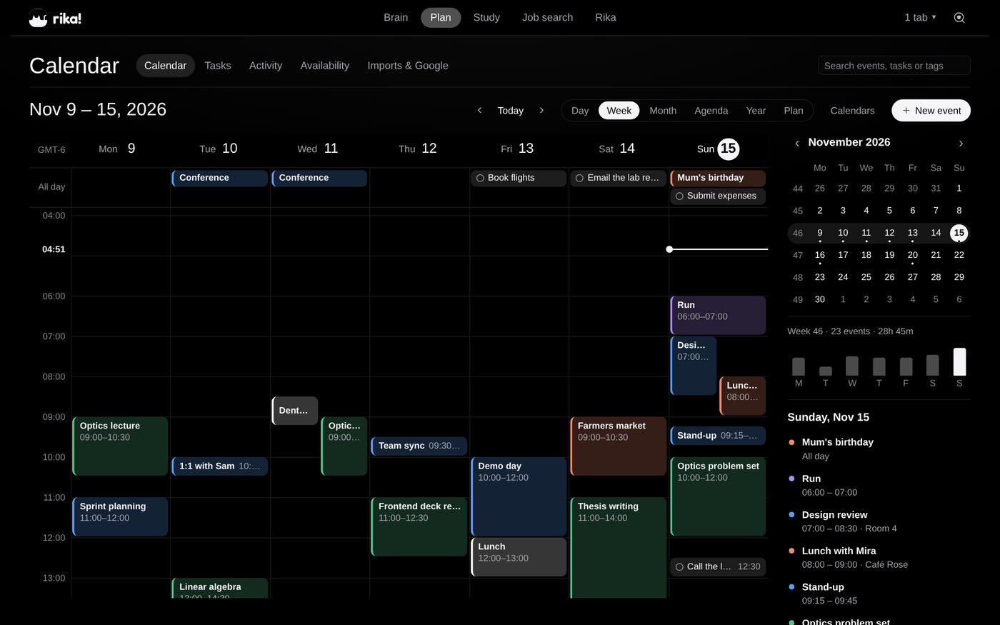
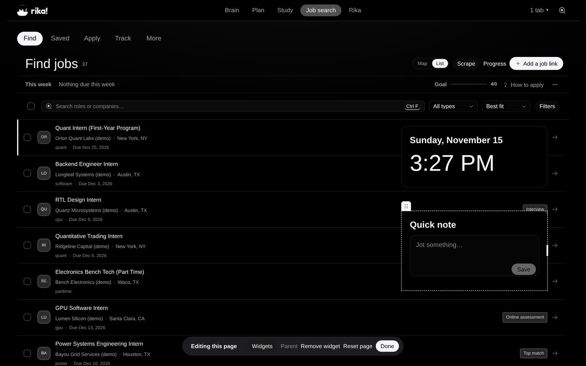

  

  Notes become connections. Connections become something you can build. 
  A local-first desktop workspace for your notes, documents, study and plans.

  <b><a href="https://github.com/ZacharySF/rika/releases/latest">Download for Linux ↗</a></b>
  &nbsp; / &nbsp; <a href="#install">Install</a>
  &nbsp; / &nbsp; <a href="#a-look-around">A look around</a> 
  Linux x86_64 · AppImage + .deb · Signed updates

 

<b>A little less scattered. A lot more connected.</b>

  

Home: today, what's next, and Rika on the right with your replies already drafted.

 

## Install

1. **[Download the latest release.](https://github.com/ZacharySF/rika/releases/latest)**
2. Install the `.deb` with your software installer, or run the AppImage.
3. Open rika! from your application launcher and choose **Start locally**.

  

First launch: one button to start locally. No account needed.

**Updates** are signed. Use **Check for updates** inside the app.
Your workspace lives apart from the application and stays put across updates.

 

## A look around

### Follow the thread

Every record and every edit becomes a glowing point in the **Brain**: a
neural-network map of everything you've written, studied and planned. Prefer
flat ground? Switch to the **2D** map.

### Give it somewhere to go

Put the next step on your calendar: one quiet row of controls, a line for now,
and the day you picked beside it.

### Someone to hand the loose ends to

Rika reads what changed overnight and tells you in a few lines. She drafts the
replies; **you** press Send. Her own page shows the coding agents working for you.

### Your desk, not ours

Press **Ctrl + Shift + Space** on any page. Drag a block where you want it, pull
an edge to resize it, and open **Widgets** to drag in a clock, a quick note or
your goals.

### Black by default. Loud when you want it.

rika! opens in **Black**: white type, hairlines, nothing glowing. Turn Themes on
for seventeen more, and Animations if you want pages to turn instead of blink.

### Only the parts you want

Keep the workspace, add a terminal when you're building, turn on ApplyAI when
you're looking for work, or download the Brain, Themes and Animations. Disabled
modules disappear; their data stays.

  

Screenshots use a demo workspace with synthetic data.

 

## About this repository

This repository holds the official installers and signed update metadata.
The application source is maintained in a separate private repository.

**Never share your workspace, credentials, resumes or private database in an issue.**

The wordmark uses <a href="https://fraunces.undercase.xyz">Fraunces</a> by Undercase Type, embedded under the <a href="docs/assets/OFL-Fraunces.txt">SIL Open Font License</a>.
